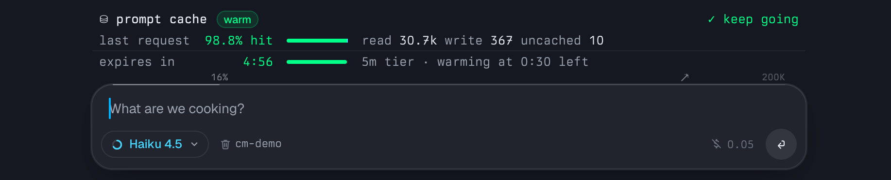
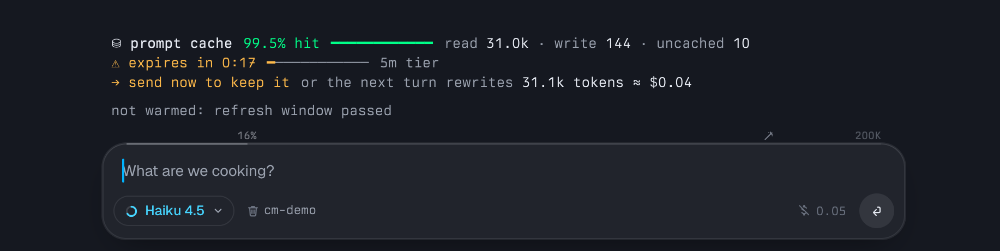
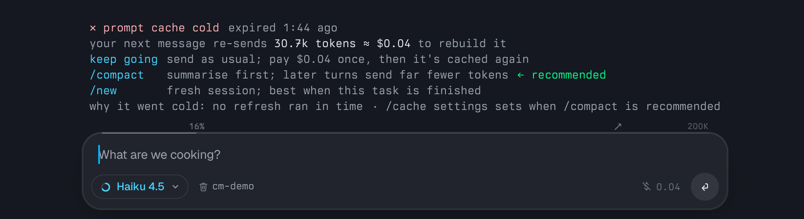
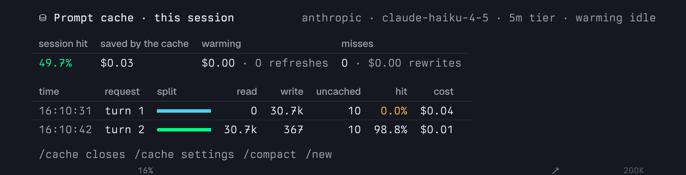
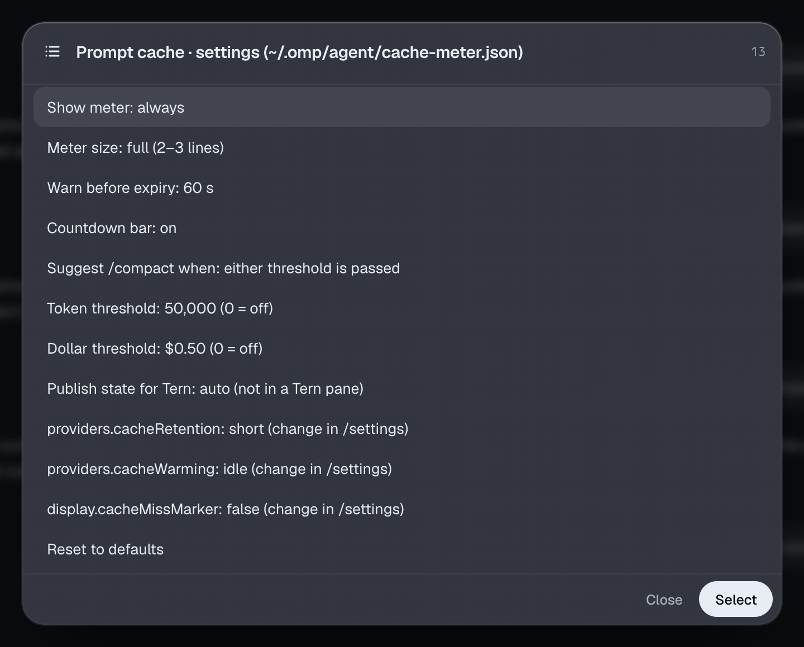

# omp-cache-meter

A prompt-cache meter for [omp](https://github.com/can1357/oh-my-pi). It shows how many tokens each request read from the cache, wrote to it and sent uncached, and counts down to the cache's expiry. When the cache goes cold it tells you whether to keep going, `/compact` or start fresh. It also includes a plugin for Tern, Stencil's terminal, that shows every agent's cache in one place.

<picture>
  <source media="(prefers-color-scheme: light)" srcset="docs/screenshots/omp-meter-warm-light.png">
  
</picture>

The repo has two parts:

| Part | Runs in | Does |
|---|---|---|
| [`omp-extension/`](omp-extension) | omp | Draws the meter above the composer and adds the `/cache` panel and `/cache settings`. In a Tern pane it also writes one state file per pane. |
| [`tern-plugin/`](tern-plugin) | Tern | Reads those state files. It adds a status-line segment, a countdown on tab titles, a toast shortly before an agent's cache expires, and a canvas listing every agent. |

The omp extension works on its own in any terminal. The Tern plugin needs the extension.

## Install

Requires omp 18.8 or newer (tested on 18.8.6 and 18.12.1). The plugin needs Tern 0.8 (tested on 0.8.2).

```sh
git clone https://github.com/andreiverdes/omp-cache-meter.git
cd omp-cache-meter

# omp: any directory in ~/.omp/agent/extensions with a package.json is loaded at startup
ln -s "$PWD/omp-extension" ~/.omp/agent/extensions/cache-meter

# Tern (optional)
tern plugin link "$PWD/tern-plugin"
```

omp sessions that are already running pick up the extension only after a restart.

## The meter

The meter sits above the composer and redraws every second. Its colour and text follow the cache's state:

| State | When | Shows |
|---|---|---|
| Warm | More than the warning time left, or omp will refresh the cache in time | Hit %, token split, countdown, tier, the planned refresh, `✓ keep going` |
| Expiring | Inside the warning time (default 60 s) with no refresh planned | `⚠ expires in`, what the next turn would rewrite and cost, why omp won't warm it |
| Cold | The cache entry has expired | How long ago, what your next message re-sends and costs, one line per way on (below), and why it went cold |
| Reset by `/compact` | A compaction (manual or automatic) is newer than the last request | Tokens before → after, what the next request writes for the new prefix, `✓ keep going` |



<picture>
  <source media="(prefers-color-scheme: light)" srcset="docs/screenshots/omp-meter-cold-light.png">
  
</picture>

(For the cold screenshot the token threshold was lowered to 20,000 so the 30.7k-token demo prefix passes it.)

On a cold cache your next message has to re-send the whole conversation to rebuild the cache. The meter lists three ways on, one per line, and marks one as recommended:

| Option | What it does | When to pick it |
|---|---|---|
| keep going | Send your next message as usual. It pays the rewrite once, then the cache is warm again. | Small or mid-sized conversations, or when you need the full history. |
| `/compact` | omp summarises the conversation, and later turns send the summary instead of the full history. | Large conversations. The summary request reads the old history once more, but every turn after it, and every later expiry, costs less. |
| `/new` | Starts a fresh session with nothing to rebuild. | The task you were on is finished. |

`/compact` is recommended when the prefix passes a token threshold, the rewrite passes a dollar threshold, or either one (the default); otherwise keep going is. The thresholds are in `/cache settings`.

### `/cache`

`/cache` toggles a panel with session totals and the last eight requests, including warming refreshes and misses.

<picture>
  <source media="(prefers-color-scheme: light)" srcset="docs/screenshots/omp-cache-panel-light.png">
  
</picture>

### `/cache settings`

`/cache settings` edits the extension's settings in place and shows the omp settings the meter follows, read-only.



Settings live in `~/.omp/agent/cache-meter.json`. A missing or invalid field falls back to its default:

| Setting | Default | Meaning |
|---|---|---|
| `meter.show` | `always` | `always`, `near-expiry` (only when expiring or cold) or `off` |
| `meter.size` | `full` | `full` (2–3 lines) or `compact` (1 line) |
| `meter.warnLeadSeconds` | `60` | When a cache with no planned refresh counts as expiring |
| `meter.countdownBar` | `true` | The bar next to the countdown |
| `advice.rule` | `either` | `tokens`, `dollars` or `either`: what triggers the `/compact` advice |
| `advice.tokenThreshold` | `50000` | Prefix size, in tokens, that triggers it; `0` turns it off |
| `advice.dollarThreshold` | `0.5` | Rewrite cost, in USD, that triggers it; `0` turns it off |
| `tern.publish` | `auto` | Write the state file when `TERN_PANE` is set; `off` never writes it |

## The Tern plugin

- **Status-line segment:** `⛁ 4:12 · 97.6% hit` for the focused agent. Clicking it opens the canvas. Tern's status bar must be on (Settings → Appearance).
- **Tab titles:** a countdown suffix such as `olymp ⛁ 4:12`. Tern applies plugin tab titles to horizontal tabs only, so vertical tabs don't show it.
- **Toast:** one per agent when its cache is about to expire with no refresh planned (default 60 s ahead).
- **Canvas:** the palette command **Prompt cache: open** shows every agent with its split, hit %, prefix, expiry, warming and advice, plus session totals. **Focus** switches to an agent; **Compact** sends it `/compact`.
- **Settings:** **Prompt cache: settings** (or the canvas's Settings button) opens a settings canvas. Its settings are saved in the plugin's `kv.json` and shared by every window.

All colours come from the active omp or Tern theme, so light and dark themes both work.

## How it works

- **Usage:** the extension records each assistant message's usage on `message_end`. On session start it rebuilds history from the session branch, including warming refreshes stored as `model_usage` entries, so a resumed session shows its real countdown.
- **Compaction:** on `session_compact` (and for compaction entries when it rebuilds) the meter drops the old countdown: the summary replaces the conversation, so the cached prefix is never read again. The first turn after it is labelled `after /compact` in the panel instead of being counted as a miss.
- **Cache lifetime:** the tier comes from the `cache_control.ttl` on the request omp sends (`before_provider_request`), confirmed by Anthropic's cache-write split in the usage. The lifetime of that tier comes from the model's `promptCache` entry in omp's catalog.
- **Warming:** omp doesn't expose its warmer's state to extensions, so the extension mirrors omp's rules from `cache-warmer.ts`. A refresh is scheduled at 90% of the lifetime and at least 10 s before expiry. Idle warming stops 30 minutes after the last request, so it covers 5m entries only. Any `cache_warming_decision` and `cache_warming_end` events refine that.
- **State file:** the interactive session writes `<Tern config>/plugin-data/cache-meter/panes/<TERN_PANE>.json` atomically whenever its contents change, and deletes it on exit. Subagent and print-mode sessions have no UI and never write it.
- **Rendering:** the meter is built once as lines of spans. In a terminal those lines are painted with the omp theme's ANSI colours. In Tern they go out as native nodes through `describe()`, and narrow panes wrap between items.

## Limitations

- **Prices are estimates:** rewrite costs use the catalog's list prices. 1h cache writes are estimated at 1.6× the 5m write price.
- **Warming is mirrored, not read:** if omp changes its warming rules, the "warming at …" line can drift until the extension follows.
- **Some Tern surfaces depend on your layout:** the segment needs the status bar, and the tab countdown needs horizontal tabs.

## Development

```sh
cd omp-extension
bun install       # type definitions only; omp supplies zod and its own API at runtime
bun run check     # tsc --noEmit
```

The screenshots were rendered offscreen with `tern shot`, from a real omp session in Tern using Claude Haiku 4.5 with `providers.cacheRetention: short`.
